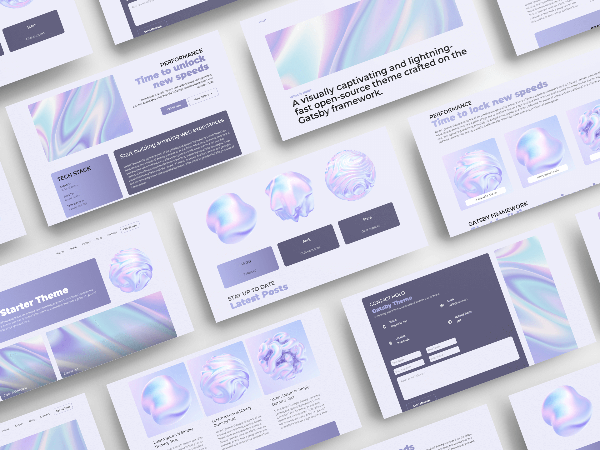

# Mila's Portfolio



Portfolio of Mila, UI/UX designer. Built on the [react-portfolio-template](https://github.com/chetanverma16/react-portfolio-template) theme by Chetan Verma, upgraded to Next.js 14.

## Tech Stack

- Next.js 14 (static export) + React 18
- Tailwind CSS 3, next-themes (dark mode), GSAP
- Decap CMS at `/admin/`
- Netlify (hosting + Forms)

## Develop

```bash
npm install
npm run dev      # http://localhost:3000
npm run build    # static site in out/
```

## Edit content

- Site copy (taglines, services, about, testimonial): `data/portfolio.json`
- Projects: `content/projects/*.md`
- Art pieces: `content/arts/*.md`
- Images: `public/img/` (reference as `/img/...`)

Or use the CMS at `/admin/` on the deployed site.
